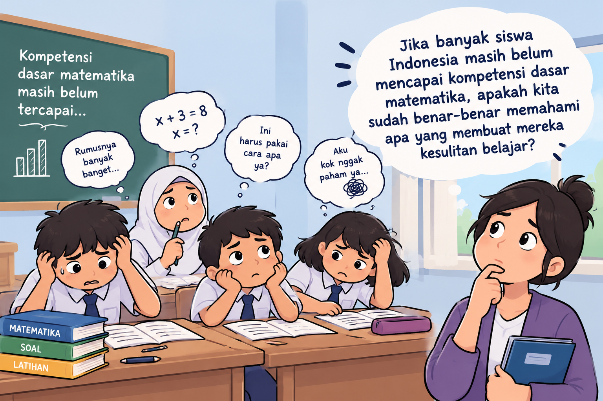

PISA 2025 memberikan gambaran yang menarik tentang pendidikan Indonesia. Menurut [catatan negara OECD untuk Indonesia](https://www.oecd.org/en/publications/pisa-2025-results-volume-i-country-notes_2d4ff9ea-en/indonesia_9c880f8a-en.html), 80% siswa menyatakan penasaran terhadap berbagai hal, 74% mengaku berusaha lebih keras ketika menghadapi pekerjaan yang sulit, dan 90% menyatakan meminta bantuan guru ketika membutuhkannya. Namun, hanya 17% siswa Indonesia mencapai sekurang-kurangnya Level 2 dalam matematika.

Angka-angka tersebut menggambarkan aspek yang berbeda dari pengalaman belajar dan capaian siswa. Kita tidak dapat langsung menyimpulkan bahwa siswa yang memiliki rasa ingin tahu atau bersedia berusaha pasti akan mencapai kompetensi yang baik. Namun, temuan tersebut memberi alasan untuk mengajukan pertanyaan lebih lanjut: **apa yang terjadi selama proses belajar sehingga sikap positif terhadap pembelajaran belum selalu tercermin dalam capaian kompetensi?**

Pertanyaan ini menjadi semakin relevan ketika AI mulai digunakan secara luas dalam kegiatan belajar. OECD melaporkan bahwa 53% siswa Indonesia menggunakan chatbot AI untuk membantu belajar setidaknya sekali seminggu.

Diskusi tentang bagaimana guru dan sistem pendidikan merespons AI tentu penting. Namun, saya merasa ada persoalan yang perlu mendapat perhatian lebih mendasar. Sebelum membahas bagaimana teknologi dapat membantu pembelajaran, kita perlu memahami apa yang sebenarnya terjadi ketika siswa belajar.

Di sinilah pentingnya *learning evidence*.

## Kita memiliki banyak data, tetapi belum tentu memahami proses belajar

Sistem pendidikan menghasilkan banyak data: nilai ujian, nilai rapor, hasil asesmen, kehadiran, data sekolah, hingga survei tentang motivasi dan pengalaman belajar siswa. Data tersebut penting untuk menggambarkan kondisi pendidikan. Namun, apakah data yang tersedia sudah cukup untuk menjelaskan bagaimana siswa belajar?

Mengetahui bahwa seorang siswa memperoleh nilai rendah memberi kita informasi tentang hasil asesmennya. Akan tetapi, nilai tersebut belum tentu menjelaskan letak kesulitannya. Apakah siswa belum memahami konsep? Apakah ia kesulitan memilih strategi penyelesaian? Apakah ia dapat mengikuti prosedur, tetapi belum memahami alasan di baliknya? Ataukah ia memahami materi dalam contoh yang familiar, tetapi kesulitan menerapkannya pada persoalan yang berbeda?

Persoalan serupa muncul ketika kita mengetahui bahwa siswa memiliki motivasi belajar yang baik. Motivasi merupakan hal penting, tetapi tidak dengan sendirinya menunjukkan bahwa pembelajaran berlangsung secara efektif.

Menurut saya, di sinilah kita perlu membedakan antara data tentang siswa, data tentang hasil belajar, dan bukti yang membantu kita memahami proses belajar.

**Kita mungkin mengetahui hasil yang dicapai siswa, tetapi belum tentu mengetahui bagaimana hasil tersebut terbentuk.**

Perbedaan ini penting karena menentukan apakah informasi yang kita miliki benar-benar dapat digunakan untuk memperbaiki pembelajaran.

## Learning evidence bukan sekadar nilai

*Learning evidence* dapat dipahami sebagai bukti yang membantu kita mengetahui apa yang telah dipahami siswa, bagaimana mereka berpikir, kesulitan apa yang dihadapi, dan bagaimana pemahaman mereka berkembang.

Dalam pembelajaran matematika, misalnya, bukti belajar tidak cukup berupa jawaban akhir. Kita juga perlu memperhatikan cara siswa memahami masalah, memilih strategi, menggunakan representasi, menjelaskan alasan, dan memeriksa kembali hasil pekerjaannya.

Dua siswa dapat memperoleh jawaban yang sama, tetapi melalui proses berpikir yang berbeda. Seorang siswa mungkin memahami konsep yang digunakan, sementara siswa lain sekadar mengikuti contoh atau mengingat prosedur. Jika kita hanya melihat jawaban akhir, perbedaan tersebut sulit diketahui.

Bukti yang lebih informatif dapat diperoleh ketika siswa diminta menjelaskan alasan di balik jawabannya, menunjukkan langkah penyelesaian, membandingkan strategi, atau memperbaiki kesalahan setelah menerima umpan balik.

Bukti belajar juga tidak harus selalu berbentuk data digital. Hasil pekerjaan siswa, pertanyaan yang mereka ajukan, catatan observasi guru, diskusi kelas, dan refleksi siswa dapat memberikan informasi yang relevan.

Yang penting bukan seberapa canggih alat yang digunakan, melainkan apakah bukti yang dikumpulkan membantu menjawab pertanyaan tentang pembelajaran.

Karena itu, pertanyaan guru seharusnya tidak berhenti pada *"Berapa nilai siswa?"*, tetapi juga mencakup *"Apa yang dapat saya simpulkan tentang pemahaman siswa dari pekerjaan mereka?"*

## Data baru berguna ketika membantu kita menentukan tindakan

Memiliki data saja tidak cukup. Data perlu ditafsirkan dan dihubungkan dengan keputusan pembelajaran.

Misalnya, seorang guru menemukan bahwa banyak siswa salah menjawab soal pecahan. Temuan ini merupakan informasi awal, tetapi belum cukup untuk menentukan tindak lanjut.

Guru perlu memeriksa pekerjaan siswa untuk mengetahui pola kesalahannya. Apakah siswa belum memahami makna pecahan? Apakah mereka keliru ketika menjumlahkan pecahan dengan penyebut berbeda? Apakah mereka memahami prosedur, tetapi kesulitan menjelaskan mengapa prosedur tersebut digunakan?

Setiap pola kesalahan dapat menunjukkan kebutuhan belajar yang berbeda. Jika persoalannya adalah pemahaman konsep, menambah latihan prosedural saja belum tentu membantu. Sebaliknya, jika siswa sudah memahami konsep tetapi belum terampil melakukan perhitungan, bentuk bantuan yang diperlukan mungkin berbeda.

Contoh sederhana ini menunjukkan bahwa data perlu diikuti dengan interpretasi. Hasil asesmen tidak seharusnya hanya digunakan untuk mengelompokkan siswa berdasarkan nilai, tetapi juga untuk memahami kebutuhan belajar mereka.

Prosesnya dapat berlangsung secara berulang: guru mengumpulkan bukti, mengidentifikasi pola, menafsirkan kesulitan, menentukan tindak lanjut, kemudian memeriksa apakah tindak lanjut tersebut menghasilkan perubahan.

Dengan demikian, data tidak hanya berfungsi untuk menilai siswa. Data juga menjadi dasar untuk mengevaluasi apakah strategi pembelajaran yang digunakan sudah sesuai dengan kebutuhan mereka.

## Peran guru dan pentingnya learning evidence

Dalam diskusi tentang AI, pentingnya *professional judgement* guru sering ditekankan. Saya sependapat bahwa pertimbangan profesional guru tetap sangat penting. Namun, pertimbangan tersebut akan lebih kuat jika didukung oleh bukti yang relevan.

Guru mungkin melihat bahwa sebagian besar siswa dapat mengikuti contoh yang diberikan di kelas. Akan tetapi, ketika diminta menyelesaikan soal secara mandiri atau menjelaskan alasan di balik jawabannya, sebagian siswa ternyata masih mengalami kesulitan.

Sebaliknya, siswa yang jarang berbicara di kelas belum tentu tidak memahami materi. Pekerjaan tertulis atau penjelasan individual mungkin menunjukkan hal yang berbeda.

Artinya, apa yang tampak selama pembelajaran belum tentu memberikan gambaran lengkap tentang pemahaman siswa.

Learning evidence membantu guru memeriksa kembali penilaiannya, mengenali kesulitan yang mungkin tidak terlihat, dan menentukan tindak lanjut yang lebih sesuai. Bukti tersebut tidak menggantikan pengalaman atau pertimbangan profesional guru. Justru, bukti dapat membantu guru menggunakan pengalaman dan pertimbangannya secara lebih terarah.

Hal ini juga berarti bahwa pengumpulan data tidak perlu menjadi pekerjaan administratif tambahan yang terpisah dari kegiatan mengajar. Bukti belajar dapat diperoleh melalui aktivitas yang memang sudah menjadi bagian dari pembelajaran, asalkan aktivitas tersebut dirancang untuk memberikan informasi yang berguna.

## Ketika AI bisa memberi jawaban, apa yang sebenarnya kita nilai?

Kehadiran AI membuat kebutuhan akan learning evidence semakin penting.

Menurut OECD, 53% siswa Indonesia menggunakan chatbot AI untuk membantu belajar setidaknya sekali seminggu. Angka ini menunjukkan bahwa AI sudah menjadi bagian dari pengalaman belajar banyak siswa. Namun, frekuensi penggunaan tersebut tidak menjelaskan apakah siswa memperoleh pemahaman yang lebih baik melalui penggunaannya.

Ada perbedaan antara AI membantu siswa menyelesaikan tugas dan AI membantu siswa belajar.

Seorang siswa dapat meminta AI menyelesaikan soal matematika dan memperoleh jawaban yang benar. Namun, jawaban tersebut belum cukup untuk menunjukkan bahwa siswa memahami konsep yang digunakan, mampu menjelaskan prosedurnya, atau dapat menyelesaikan persoalan serupa secara mandiri.

Sebaliknya, AI dapat digunakan sebagai bagian dari aktivitas yang membantu guru memperoleh bukti tentang pemahaman siswa. Siswa, misalnya, dapat diminta memeriksa solusi yang dihasilkan AI, menemukan kesalahan, membandingkan strategi, atau menjelaskan mengapa suatu langkah penyelesaian dapat diterima atau perlu diperbaiki.

Aktivitas seperti ini memberi kesempatan kepada siswa untuk menunjukkan proses berpikirnya. Guru pun memiliki informasi yang lebih kaya untuk menilai pemahaman mereka.

Tentu saja, penggunaan AI dalam aktivitas tersebut tidak otomatis menjamin terjadinya pembelajaran. Kita tetap perlu memeriksa apakah siswa benar-benar memahami konsep dan mampu menggunakan pengetahuan tersebut pada persoalan lain.

Karena itu, pertanyaan tentang AI tidak cukup berhenti pada apakah siswa menggunakannya atau apakah tugas mereka menjadi lebih baik. Kita juga perlu bertanya: **bukti apa yang menunjukkan bahwa penggunaan AI membantu siswa belajar?**

## Kita perlu mengukur apa yang benar-benar ingin kita kembangkan

Jika jawaban akhir semakin mudah diperoleh dengan bantuan AI, maka penilaian yang hanya berfokus pada jawaban akhir berisiko memberikan gambaran yang tidak lengkap tentang kemampuan siswa.

Dalam matematika, misalnya, kita tidak hanya ingin siswa memperoleh jawaban yang benar. Kita juga ingin mereka memahami konsep, bernalar, memilih strategi, menjelaskan alasan, dan memeriksa apakah hasil yang diperoleh masuk akal.

Jika kemampuan-kemampuan tersebut merupakan tujuan pembelajaran, maka asesmen dan aktivitas belajar perlu memberikan kesempatan kepada siswa untuk menunjukkan bukti penguasaannya.

Hal ini bukan berarti setiap tugas harus dibuat rumit atau seluruh proses berpikir siswa harus direkam secara digital. Guru dapat memulai dengan pertanyaan yang meminta alasan, tugas yang memungkinkan beberapa strategi penyelesaian, atau kesempatan bagi siswa untuk memperbaiki jawaban setelah memperoleh umpan balik.

Yang perlu dipastikan adalah adanya kesesuaian antara tujuan pembelajaran, bukti yang dikumpulkan, dan keputusan yang diambil berdasarkan bukti tersebut.

Hal yang sama berlaku ketika kita mengevaluasi penggunaan AI. Jika tujuan kita adalah meningkatkan pemahaman, maka keberhasilan tidak cukup dinilai dari kecepatan menyelesaikan tugas atau kualitas jawaban yang diserahkan. Kita perlu memeriksa apakah pemahaman siswa berkembang dan apakah mereka mampu menerapkan pengetahuan tersebut secara lebih mandiri.

## Persoalannya bukan sekadar kekurangan data

PISA memberi kita informasi penting tentang capaian dan pengalaman belajar siswa. Namun, hasil asesmen berskala besar tidak dengan sendirinya menjelaskan seluruh proses yang menghasilkan capaian tersebut.

Demikian pula, semakin banyaknya data pendidikan tidak otomatis membuat kita semakin memahami pembelajaran. Kita dapat memiliki banyak nilai ujian tanpa mengetahui kesulitan yang mendasarinya. Kita dapat mengetahui seberapa sering siswa menggunakan AI tanpa mengetahui apakah penggunaan tersebut membantu mereka memahami materi.

Karena itu, persoalannya bukan semata-mata bagaimana menghasilkan lebih banyak data, melainkan bagaimana memperoleh dan menggunakan *learning evidence* yang bermakna.

Bukti tersebut tidak harus selalu berbentuk data dalam jumlah besar. Beberapa contoh pekerjaan siswa, pertanyaan diagnostik yang dirancang dengan baik, atau catatan tentang kesalahan yang berulang dapat menjadi titik awal. Namun, kita perlu menafsirkan bukti secara hati-hati. Satu jawaban salah tidak selalu menunjukkan miskonsepsi yang menetap, sebagaimana satu jawaban benar tidak selalu membuktikan pemahaman yang mendalam.

Kita perlu mempertimbangkan berbagai bukti sesuai dengan pertanyaan yang ingin dijawab dan menggunakannya untuk menentukan langkah pembelajaran berikutnya.

Pada akhirnya, PISA seharusnya tidak hanya mendorong kita untuk mempertanyakan mengapa capaian siswa masih menjadi tantangan. Temuan tersebut juga dapat menjadi alasan untuk memeriksa apakah kita sudah memiliki bukti yang cukup tentang apa yang terjadi selama proses belajar.

AI membuat pertanyaan ini semakin relevan. Ketika teknologi dapat menghasilkan jawaban dengan semakin mudah, kita perlu semakin cermat membedakan hasil pekerjaan dari hasil belajar.

**Pertanyaan pentingnya bukan hanya apakah siswa menggunakan AI atau apakah guru mampu mengintegrasikannya, tetapi apakah kita memiliki bukti yang cukup untuk mengetahui bahwa siswa benar-benar belajar.**

Sebab, semakin mudah teknologi menghasilkan jawaban, semakin penting bagi kita untuk memahami apa yang ada di balik jawaban tersebut.
