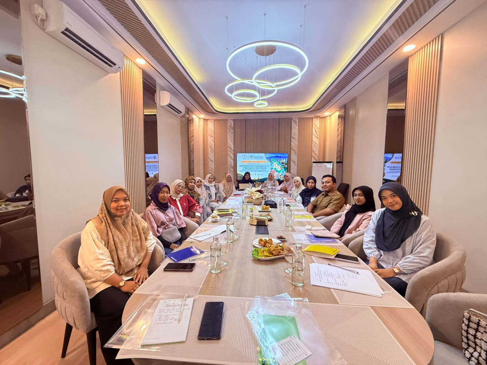
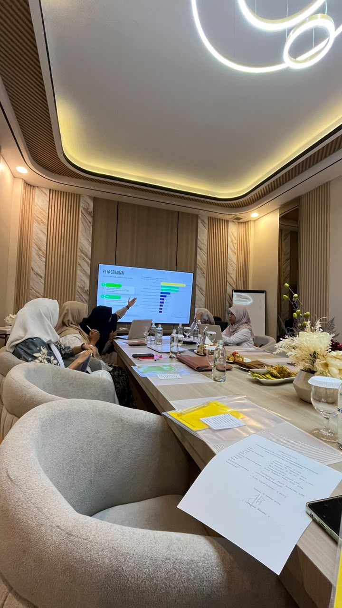
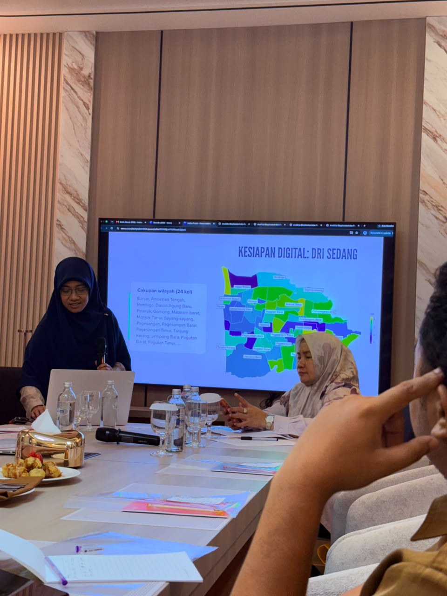
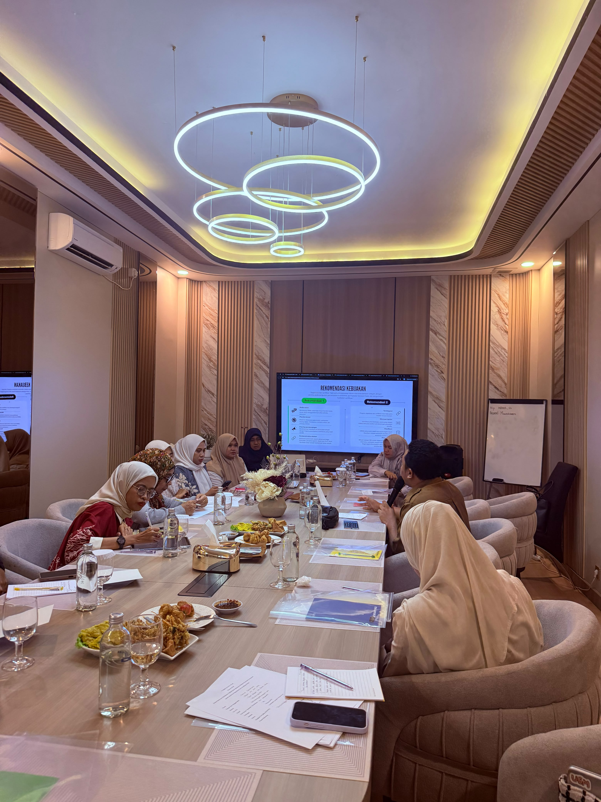
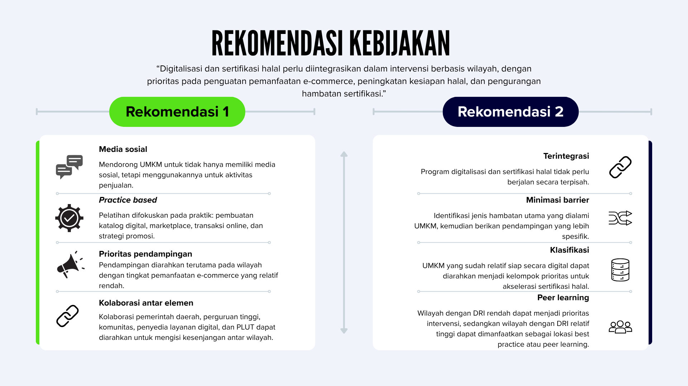

> Bagaimana kita dapat memahami kebutuhan UMKM dengan lebih baik? Tidak cukup hanya dengan melihat jumlah usaha atau distribusinya berdasarkan wilayah. Di balik setiap titik pada peta, terdapat pelaku usaha dengan karakteristik, tantangan, dan kebutuhan yang berbeda.

Pertanyaan tersebut menjadi salah satu hal yang kami bawa dalam **Focus Group Discussion (FGD) dan sharing session** hasil riset *“Zonasi Intervensi Kebijakan UMKM Kota Mataram: Pemetaan Geospasial untuk Akselerasi Digitalisasi dan Sertifikasi Halal”* yang dilaksanakan pada Selasa, 13 Oktober 2026, di Camoris Cafe, Mataram. Kegiatan yang berlangsung pada pukul 10.00–12.30 WITA ini menjadi kesempatan bagi kami untuk tidak hanya mempresentasikan hasil penelitian, tetapi juga mendengarkan perspektif dari pihak-pihak yang berhadapan langsung dengan persoalan pengembangan UMKM.

::: {#fig-fgd layout-ncol=2}

{width="100%" height="300"}

{width="100%" height="300"}

*Focus group discussion* dan *sharing session* riset DUDI UIN Mataram
:::

Riset ini dikerjakan oleh tim lintas fakultas di UIN Mataram yang melibatkan tiga fakultas, yaitu Fakultas Tarbiyah dan Keguruan (FTK), Fakultas Ekonomi dan Bisnis Islam (FEBI), serta Fakultas Ushuluddin dan Studi Agama (FUSA). Tim peneliti terdiri atas **Indira Puteri Kinasih, Ph.D., Dr. Any Tsalasatul Fitriyah, Nurul Susianti, M.SEI., Ulfatun Hasanah, M.AP., dan Nur Awalunnisa, M.SEI.**


### Mengenali sebaran UMKM melalui peta interaktif

Salah satu keluaran utama penelitian ini adalah **peta interaktif UMKM Kota Mataram**.
Peta tersebut tidak hanya menunjukkan lokasi UMKM, tetapi juga memungkinkan karakteristik masing-masing usaha dilihat berdasarkan wilayah.
Dengan pendekatan ini, data UMKM tidak berhenti sebagai tabel atau angka.
Persebarannya dapat dilihat secara spasial sehingga pola dan perbedaan antarwilayah menjadi lebih mudah dipahami.

```{r, echo=FALSE, warning=FALSE, message=FALSE}
#| label: fig-mtrumkm_point
#| fig-cap: "Sebaran geografis UMKM kota Mataram"

library(tidyverse)
library(ggplot2)
library(dplyr)
library(spdep)
library(leaflet)
library(tidyr)

load("umkm_geo2.RData")
load("mtrvlg_umkm2.RData")

umkm_sf <- umkm_geo2 %>%
  filter(
    !is.na(latitude),
    !is.na(longitude)
  ) %>%
  st_as_sf(
    coords = c("longitude", "latitude"),
    crs = 4326,
    remove = FALSE
  )

skala_colors <- c(
  "Usaha Mikro" = "blue",
  "Usaha Kecil" = "green",
  "Usaha Menengah" = "orange",
  "Usaha Besar" = "red"
)

leaflet() %>%
  addTiles() %>%
  addPolygons(
  data = mtrvlg_umkm2,
  
  fillColor = ~colorNumeric(
    palette = viridisLite::viridis(256),
    domain = mtrvlg_umkm2$jumlah_umkm
  )(jumlah_umkm),
  
  fillOpacity = 0.6,
  color = "white",
  weight = 1,
  
  label = ~paste0(
    kelurahan,
    " | ",
    kecamatan,
    " | UMKM: ",
    jumlah_umkm
  ),
  
  popup = ~paste0(
    "<b>Kelurahan:</b> ", kelurahan, "<br>",
    "<b>Kecamatan:</b> ", kecamatan, "<br>",
    "<b>Jumlah UMKM:</b> ", jumlah_umkm
  )
) %>%
  
# UMKM points

addCircleMarkers(
  data = umkm_sf,
  
  radius = 2.5,
  stroke = FALSE,
  weight = 1,
  fillOpacity = 0.5,
  # color = "black",
  fillColor = ~skala_colors[skala_usaha], #still not working!
  
  label = ~judul_kbli,
  
  popup = ~paste0(
    "<b>", judul_kbli, "</b><br><br>",
    
    "<b>Jenis usaha:</b> ", jenis_perusahaan, "<br>",
    "<b>Skala usaha:</b> ", skala_usaha, "<br>",
    "<b>Kelurahan:</b> ", kelurahan, "<br>",
    "<b>Kecamatan:</b> ", kecamatan, "<br>",
    "<b>KBLI:</b> ", kbli, "<br>",
    "<b>Luas:</b> ", luas, " m²<br>",
    "<b>Investasi:</b> Rp ",
    format(investasi, big.mark = ".", scientific = FALSE),
    "<br>",
    "<b>TKI:</b> ", tki_org
  )
)

```

Penelitian juga mengembangkan model untuk mengeksplorasi faktor-faktor yang berkaitan dengan **kesiapan digital UMKM**.
Beberapa aspek yang diperhatikan antara lain pemanfaatan *e-commerce*, infrastruktur pendukung, serta aspek kesiapan halal.
Pendekatan spasial digunakan karena kondisi UMKM di satu wilayah tidak selalu sama dengan wilayah lainnya.
Dengan mempertimbangkan konteks wilayah, hasil analisis diharapkan dapat memberikan gambaran yang lebih relevan untuk mendukung perumusan intervensi.

### Mendengar perspektif dari lapangan

Salah satu bagian yang penting dalam kegiatan ini adalah kesempatan untuk mendiskusikan hasil penelitian bersama **perwakilan Dinas Koperasi dan UKM Provinsi Nusa Tenggara Barat**.
Selain memberikan masukan terhadap hasil penelitian, perwakilan dinas juga berbagi informasi mengenai berbagai layanan dan pendampingan yang tersedia melalui **Pusat Layanan Usaha Terpadu (PLUT)**.
Informasi ini membantu kami melihat bagaimana hasil penelitian dapat dihubungkan dengan ekosistem layanan yang sudah tersedia bagi UMKM.

::: {#fig-fgd layout-ncol=2}

{width="100%" height="300"}

{width="100%" height="300"}

Diskusi dan tanya jawab bersama peserta
:::

<!-- ::: {layout-ncol=2} -->

<!-- {fig-alt="Pemaparan hasil oleh tim riset"} -->

<!-- {fig-alt="Diskusi bersama peserta FGD"} -->

<!-- ::: -->

Yang tidak kalah penting, FGD juga menghadirkan **perwakilan pelaku UMKM**.
Kehadiran mereka memberikan perspektif yang berbeda dari data dan model statistik yang selama ini kami kerjakan.
Diskusi berlangsung cukup hidup ketika para pelaku UMKM menyampaikan pertanyaan mengenai **pengurusan sertifikasi halal** dan berbagai bentuk pendampingan yang dapat diakses.
Mereka juga menunjukkan ketertarikan terhadap persoalan **jaminan dan peningkatan kualitas produk**, serta bagaimana layanan yang tersedia melalui PLUT dapat membantu mereka memenuhi kebutuhan tersebut.

Bagi kami, pertanyaan-pertanyaan tersebut menjadi pengingat bahwa di balik istilah seperti *digital readiness* dan *halal readiness*, terdapat kebutuhan yang sangat konkret dari pelaku usaha.
Bagi pelaku UMKM, kesiapan digital bukan sekadar sebuah indeks, dan sertifikasi halal bukan sekadar sebuah variabel dalam penelitian.
Keduanya berkaitan langsung dengan bagaimana usaha dapat berkembang, memenuhi tuntutan pasar, dan meningkatkan kualitas produknya.

### Rekomendasi kebijakan berbasis data

FGD ini juga dihadiri oleh **Dekan Fakultas Ekonomi dan Bisnis Islam serta Kepala Pusat LP2M UIN Mataram**, yang turut memberikan masukan terhadap hasil penelitian dan arah pengembangannya.
Berbagai masukan yang diperoleh dalam diskusi menjadi bagian penting dalam tahap akhir penelitian.
Kami tidak hanya ingin menghasilkan peta dan model statistik, tetapi juga memastikan bahwa hasil analisis tersebut dapat diterjemahkan menjadi informasi yang lebih mudah digunakan oleh pemangku kepentingan.



Karena itu, keluaran akhir penelitian ini diarahkan pada penyusunan **policy brief** mengenai peningkatan *digital readiness* dan *halal readiness* UMKM Kota Mataram.
Policy brief tersebut diharapkan dapat mempertemukan tiga hal: **apa yang ditunjukkan oleh data, apa yang dibutuhkan oleh pelaku UMKM, dan apa yang dapat dilakukan melalui kebijakan serta layanan yang tersedia.**

Pada akhirnya, pemetaan spasial bukan hanya tentang mengetahui di mana UMKM berada.
Yang lebih penting adalah menggunakan informasi mengenai *di mana*, *bagaimana karakteristiknya*, dan *apa kebutuhannya* untuk membantu merumuskan intervensi yang lebih sesuai dengan kondisi masing-masing wilayah.
FGD hari ini menjadi salah satu langkah dalam proses tersebut: membawa hasil analisis keluar dari layar komputer, mempertemukannya dengan pengalaman di lapangan, dan kemudian kembali mengolahnya menjadi rekomendasi yang lebih kontekstual.